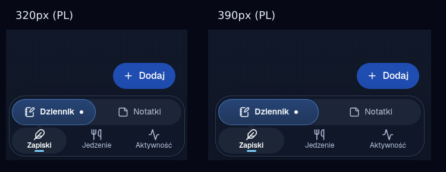

# Mobile navigation: Labeled Dock (#253)

Preview: real application chrome rendered with fixture content, not live account data.
Independent Chromium review covered EN/PL at 320, 360, 390, 720, 900, and 1280px,
route switching, current states, selection takeover, focus layouts, and reduced motion.
The parent also ran the full check and build commands. Backend workflows were not exercised.

## TL;DR

Keep all six destinations as one-tap links in the phone bottom dock, and show a visible label
under every icon. Give Diary, Notes, and Recipes icons with different silhouettes. Mark the
current page with a filled pill shape behind the icon and with `aria-current="page"`.

## Problem

The phone dock shows six icon-only toggles. Diary (`NotebookPenIcon`), Notes (`ListTodoIcon`),
and Recipes (`BookOpenIcon`) all look like documents at 20px, so users tap the wrong one. The
toggles also expose `aria-pressed` instead of `aria-current`, so assistive technology hears
"toggle button, pressed" and not "current page".

## Selected design

### Destinations and icons

| Order | Destination | EN       | PL       | Icon              | Silhouette                     |
| ----- | ----------- | -------- | -------- | ----------------- | ------------------------------ |
| 1     | Diary       | Diary    | Dziennik | `NotebookPenIcon` | tall bound notebook with a pen |
| 2     | Notes       | Notes    | Notatki  | `StickyNoteIcon`  | square note, folded corner     |
| 3     | Recipes     | Recipes  | Przepisy | `CookingPotIcon`  | wide pot with lid and handles  |
| 4     | Weight      | Weight   | Waga     | `ScaleIcon`       | balance scale (unchanged)      |
| 5     | Workouts    | Workouts | Treningi | `DumbbellIcon`    | dumbbell (unchanged)           |
| 6     | Calories    | Calories | Kalorie  | `FlameIcon`       | flame (unchanged)              |

- The three confused destinations now have three different outlines: tall rectangle, square,
  and wide rounded pot. Recipes moves from "a document" to "cooking".
- Order stays the same. Users keep their muscle memory, and the desktop header keeps its order.
- The icons come from one source (`navbarItems.ts`). Desktop pills and the home dashboard tiles
  use the same icons, so one destination has one symbol everywhere.

### Dock layout

- Each item is a column: 20px icon inside a pill indicator, and an 11px semibold label below.
- Item height is 3rem (48px). Minimum item width is 2.75rem (44px).
- The dock uses the full phone width minus a 0.5rem gutter and the horizontal safe-area insets,
  up to 28rem. The old 22rem cap left about 46px per item at 360px and was too tight for labels.
- Items fill implicit grid columns sized `minmax(max-content, 1fr)`. Long labels (`Dziennik`, `Przepisy`, `Treningi`) get
  the space that they need, and short labels share the remaining space. Labels never use
  ellipsis and never wrap.
- Width budget at 320px, measured with Geist at 11px/600: the dock has 294px of inner width. The
  six columns (label + 4px padding, minimum 44px) need 281px in Polish and 284px in English
  (`Workouts` is the longest label, 53px). The items have no gap, so this headroom stays.

### Current-page state

Three signals, so the state does not depend on color alone:

1. Shape: a filled pill (`--c-primary-surface-strong` with a `--c-primary-border` ring) appears
   behind the active icon. Inactive items have no pill.
2. Contrast: the active icon and label use `--c-text-strong`; inactive items use `--c-muted`.
3. Semantics: the active link has `aria-current="page"`.

The label weight does not change between states, so the columns do not move when the page
changes.

### Semantics and keyboard

- `<nav aria-label="Primary mobile navigation">` contains a `<ul>` of plain `Link`s. The old
  Base UI `ToggleGroup` is removed: these items go to pages, they do not toggle state.
- Each link has a visible text label, so it does not need `aria-label`. The icon is
  `aria-hidden`.
- Tab and Shift+Tab move through the links in visual order. Enter opens a link.
- `:focus-visible` shows a 2px `--c-primary-focus` ring inside the item, so the dock edge does
  not clip it.

### Motion

- Only the item `color` and the indicator `background-color` change, in 160ms. The active ring
  appears without a transition.
- Nothing moves, scales, or slides. With `prefers-reduced-motion: reduce`, the transition is
  removed and the state changes immediately.

### Shared chrome that does not change

- `MobileDock.module.css` keeps the shared position, surface, and z-index. Its width and padding
  now read `--dock-width` and `--dock-padding` from `theme.css`, with the old values. Only the
  navbar overrides them, so `SelectionBar` and the rest timer keep their current size.
- While a takeover bar shows, the dock is about 10px shorter than the navbar dock. The bar sits
  at the same bottom edge, so this does not move any target.
- `SelectionBar` and the rest timer still hide the navbar through the `.selectionBar` class.
- Task and immersive routes (`layout` in `staticData`) still render no dock.
- Desktop (`not (--phone)`) still hides the dock and shows the header pills.

### Clearance

The labeled dock is about 10px taller than the old dock. Tokens in `theme.css` now hold the
geometry:

- `--dock-nav-item-height: 3rem` sizes the navbar items.
- `--dock-width` and `--dock-padding` size the shared dock; the navbar sets them to
  `min(28rem, 100vw - 1rem - horizontal safe-area insets)` and `0.25rem`.
- `--dock-nav-clearance: 4.75rem` is the space from the viewport bottom (before the safe-area
  inset) that the dock occupies, plus a gap.

`FloatingButton` and the `AppFrame` shell padding use `--dock-nav-clearance`, so the floating
action and the last control on a page stay above the taller dock. Focus-shell routes are not
changed, because they have no dock.

## Tradeoffs

- Labels cost height. The dock grows from about 47px to about 58px, so pages lose about 10px of
  visible content on phones. The floating button moves up by the same amount.
- Little headroom at 320px. About 10px remain in English and 13px in Polish. A large browser
  text-size setting can push the labels past the dock width on the narrowest phones. Wider
  phones (360px and more) have 50px or more of spare width.
- Small text. Labels are 11px (`--text-xs` is 12px). At 12px, the six columns need about
  299px in both languages and do not fit the 294px dock at 320px. 11px semibold is a common size for
  bottom tab labels, but it is near the lower limit of easy reading.
- Fixed room for growth. Six labeled items fill a 320px screen. A seventh destination does not
  fit; it needs a More sheet (alternative 3 in the issue) or the customization in #251.
- Same order. The three confusable items stay next to each other. Labels and new silhouettes
  remove the confusion, so a new order is not necessary, and it would break muscle memory.
- No roving focus. Six Tab stops replace one arrow-key group. This is the expected pattern for
  page links, and the dock is short, so the extra Tab stops are acceptable.
- No customization. #251 can later filter or reorder `NAVBAR_ITEMS` before this dock renders
  them. This change does not add it.

## Not in scope

- #251 customization (order, hide, edit mode).
- New destinations, new dependencies, or tests.

## Update: combined with More and customization (#251)

- The labeled dock now shows the user's pinned sections (max 5) and a More tab. Defaults: Diary, Notes, Recipes, Workouts, Calories.
- More opens a sheet with every section and a "Edit bottom bar" button.
- Press and hold the dock (or right-click) to open the editor: switch sections into the bar and drag them to reorder.
- Prefs are stored per device in `localStorage` (`veles.mobileNav.v1`). No database change.
- The preview image above shows the earlier six-link version.
